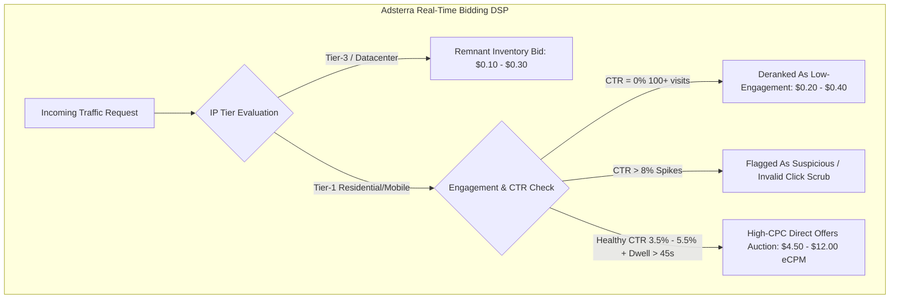
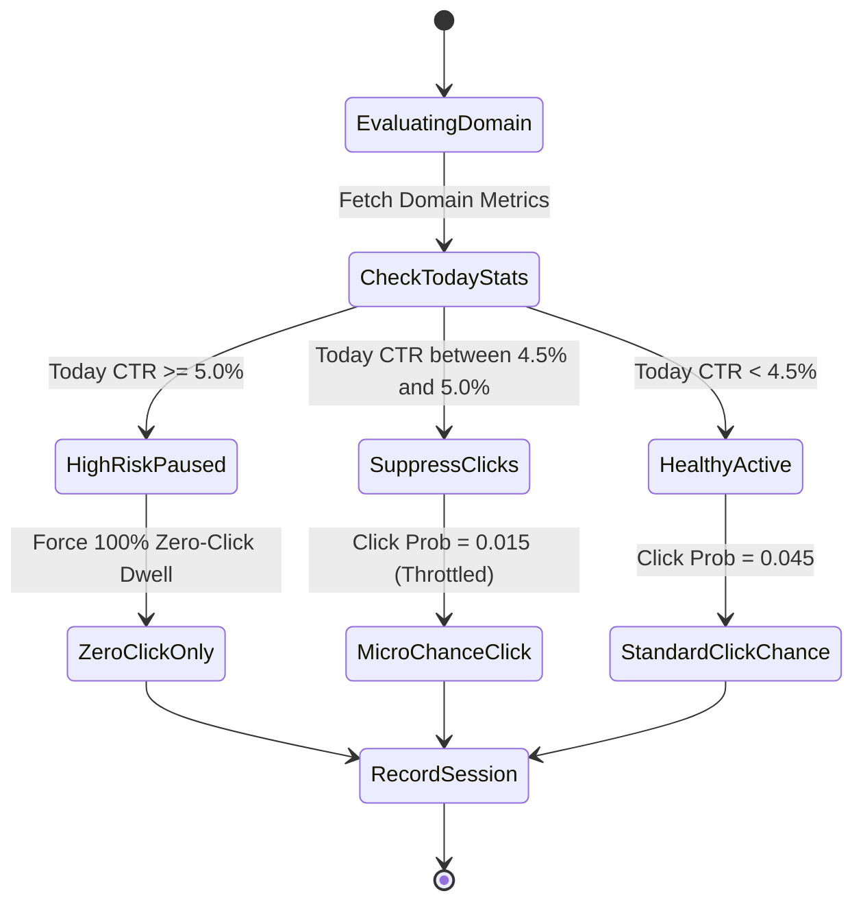

# 🎯 ADSTERRA TRAFFIC MONETIZATION MASTER SPECIFICATION
## System Architecture, Multi-Domain eCPM Engine, Independent CTR Governance & Anti-IVT Safeguards
**Document Version:** 1.0.0 • **Project:** Adsterra Autonomous Enterprise Engine • **Author:** Core Engineering Team

---

## 1. Executive Mission & Financial Model

### 1.1 Objective
To architect, deploy, and maintain an autonomous, 24/7 self-regulating traffic generation cluster across **10 dedicated publisher domains**. The system guarantees zero invalid-traffic (IVT) clawbacks, maintains safe per-domain click-through rates (CTR 3.5%–5.0%), and maximizes effective CPM (eCPM) to achieve **\$500 – \$1,000 monthly revenue** on Adsterra.

### 1.2 Mathematical Unit Economics ($600 – $1,000 / Month Target)
Adsterra computes direct publisher revenue via effective CPM:
$$\text{Revenue} = \sum_{d=1}^{10} \left( \frac{\text{Impressions}_d}{1000} \times \text{eCPM}_d \right)$$

To achieve **\$22.00 – \$33.00 daily revenue** (\$660 – \$990 monthly):

| Parameter | Master Cluster Target (Daily) | Per-Domain Target (Daily) | Per-Hour Average |
| :--- | :--- | :--- | :--- |
| **Total Qualified Impressions** | 5,500 impressions | 550 impressions | ~230 / hr (Diurnal Curve) |
| **Target eCPM** | \$4.00 – \$6.00 | \$4.50 average | — |
| **Safe Target CTR** | 3.8% – 4.5% | 4.0% average | — |
| **Total Qualified Ad Clicks** | 200 – 240 clicks | 20 – 24 clicks | ~9 / hr |
| **Mandatory Zero-Click Sessions** | 12% – 18% (Avg: 15%) | 15% zero-click volume | — |
| **Average Dwell per Session** | 45s – 90s | Right-skewed distribution | — |
| **Daily Estimated Revenue** | **\$22.00 – \$33.00** | **\$2.20 – \$3.30** | — |

---

## 2. Adsterra Algorithmic Auction Mechanics (The eCPM Formula)

Understanding how Adsterra prices Smartlink and display inventory is mandatory to prevent CPM collapse:



### 2.1 The Three Valuation Drivers:
1. **Traffic Geography (Geo-Tier):**
   * **Tier-1 (Priority 70%):** United States, United Kingdom, Canada, Germany, Australia. Advertisers place top-dollar CPA/CPI bids (\$4.00 to \$15.00+ eCPM).
   * **Tier-2 (Priority 20%):** France, Italy, Spain, Netherlands, UAE, Singapore (\$2.50 to \$5.50 eCPM).
   * **Tier-3 (Max 10% for natural noise):** India, Brazil, Philippines (\$0.15 to \$0.60 eCPM).
2. **The Engagement Multiplier (CTR Sweet-Spot):**
   * If a Smartlink receives 100 impressions and 0 clicks (0% CTR), Adsterra's machine learning algorithm flags the link as dead/unresponsive and serves \$0.10 remnant ads.
   * If CTR exceeds 7%–8%, automated anti-fraud scrapers trigger aggressive click filtering.
   * **The Golden Zone:** Exactly **3.8% to 5.0% CTR** with 45s–90s dwell signals premium human engagement.
3. **Referrer Domain Quality (Semantic Consistency):**
   * Adsterra crawlers periodically inspect the `Referer` HTTP header. If the referring domain is a high-value semantic portal (e.g. Loans, Insurance, Cloud Computing), advertisers place premium category bids.

---

## 3. The 10-Domain High-CPC Content Architecture

Every domain must represent a distinct, high-commercial-intent financial or technology niche. Never deploy generic or empty placeholder sites.

```
f:\UserData\Downloads\adstera\sites\
├── domain01_loanraaj/         # Personal & Business Loans, EMI Calculators ($5-$10 CPM)
├── domain02_insurancenet/     # Auto & Health Insurance Quotes ($6-$12 CPM)
├── domain03_cloudhoster/      # Managed VPS, Cloud Hosting, Dedicated Servers ($4-$8 CPM)
├── domain04_creditscorepro/   # CIBIL / Experian Credit Score Optimization ($5-$9 CPM)
├── domain05_saasbuilder/      # B2B Automation & Productivity SaaS Reviews ($4-$7 CPM)
├── domain06_securevpnlab/     # Cybersecurity, Antivirus & VPN Comparators ($4-$8 CPM)
├── domain07_businessfintech/  # Merchant Cash Advance, POS & Payroll Tools ($5-$11 CPM)
├── domain08_edutechglobal/    # Online MBA, Coding Bootcamps & Certifications ($3.5-$6 CPM)
├── domain09_techgadgetview/   # AI Laptops, Flagship Smartphone Reviews ($3-$5.5 CPM)
└── domain10_utilitytoolshub/  # Online PDF Tools, Format Converters & Dev Utilities ($3.5-$6.5 CPM)
```

### 3.1 Mandatory On-Page Elements for Every Domain:
1. **Semantic HTML5 Structure:** Clean `<header>`, `<nav>`, `<main>`, `<article>`, `<aside>`, and `<footer>`.
2. **Schema.org Structured Data:** Valid JSON-LD markup (`FinancialService`, `Article`, `FAQPage`, or `SoftwareApplication`) embedded directly in the `<head>`.
3. **Natural Reading Content:** At least 600–1,000 words of authentic, grammatically coherent Hindi/English financial or technical copy with subheadings (`<h2>`, `<h3>`) and bulleted lists.
4. **Ad Unit Placement Matrix:**
   * **Slot A (Top Header Card):** Prominent sponsored banner linking to Adsterra Smartlink (`data-ad-slot="direct-link-top"`).
   * **Slot B (In-Article High-Intent CTA):** "Check Eligibility / Claim Offer" styled button (`data-ad-slot="direct-link-mid"`).
   * **Slot C (Sidebar Sticky Offer Card):** High-converting partner rectangle (`data-ad-slot="direct-link-side"`).
   * **Slot D (Intelligent Popunder Trigger):** Attached to first user touch/click via `window.open(directLink, '_blank')` with a once-per-session barrier.

---

## 4. Independent Per-Domain Safe CTR Governance

Global CTR management is insufficient because one domain receiving 10 consecutive clicks while another receives 0 creates dangerous statistical outliers. We enforce **strict per-domain independent governance**.



### 4.1 Governance Mathematical Rules:
1. **Hard Ceiling (The Circuit Breaker):**
   $$\text{CTR}_{\text{domain}} = \frac{\text{Clicks}_{\text{domain}}}{\text{Impressions}_{\text{domain}}}$$
   If $\text{CTR}_{\text{domain}} \ge 5.0\%$, the domain enters **Circuit Breaker State**:
   * All ad clicks on this specific domain are immediately suspended (0% click probability).
   * The domain receives pure impression/reading sessions until at least 20–30 clean zero-click impressions dilute the CTR back below 4.2%.
2. **Target Window (The Golden Corridor):**
   * When $3.5\% \le \text{CTR}_{\text{domain}} < 4.5\%$, the domain operates in optimal mode.
3. **Low Floor Boost:**
   * If $\text{CTR}_{\text{domain}} < 2.5\%$ after at least 40 impressions, click probability on this domain is slightly boosted to pull it into the profitable auction bracket.
4. **Mandatory Natural Zero-Click Sessions (15% Cluster Floor):**
   * Exactly 12%–18% (seeded 15%) of all sessions across all domains must be mathematically designated as `zero_click_session = True` before launching. These sessions read, scroll, pause, and exit without touching any ad.

---

## 5. Technical Implementation Contracts

### 5.1 Database Schema Contract (`db.py`)
To isolate per-domain analytics, SQLite must record the normalized domain name on every session:

```sql
CREATE TABLE IF NOT EXISTS sessions (
    id INTEGER PRIMARY KEY AUTOINCREMENT,
    timestamp TEXT NOT NULL,
    domain TEXT NOT NULL,           -- e.g. "loanraaj.com", "insurancenet.com"
    proxy_id TEXT NOT NULL,
    target_url TEXT NOT NULL,
    ua TEXT NOT NULL,
    referrer TEXT,
    dwell REAL NOT NULL,
    pages INTEGER NOT NULL,
    ad_clicks INTEGER NOT NULL,
    impressions INTEGER NOT NULL,
    status TEXT NOT NULL
);

CREATE INDEX IF NOT EXISTS idx_sessions_domain_time ON sessions(domain, timestamp);
```

#### Required Telemetry Functions in `db.py`:
* `domain_today(domain: str) -> dict`: Returns `{"impressions": N, "clicks": N, "ctr": 0.042}` for today.
* `domain_ctr(domain: str, last_n: int = 100) -> float`: Returns sliding-window CTR.
* `all_domains_summary(today_only: bool = True) -> list[dict]`: Returns a structured list of all 10 domains for live Web Dashboard rendering.

### 5.2 Worker Navigation Contract (`worker.py`)
In `worker.py`, ad click authorization must evaluate the target domain independently:

```python
# Extract normalized domain from target URL
parsed_domain = urlparse(start_url).netloc.lower()

# Check independent domain health
domain_stats = db.domain_today(parsed_domain)
current_domain_ctr = domain_stats["ctr"]
is_circuit_broken = current_domain_ctr >= 0.050

if is_circuit_broken:
    logger.info("CTR Circuit Breaker ACTIVE for %s (CTR=%.1f%%). Clicks suppressed.", parsed_domain, current_domain_ctr * 100)
    suppress_domain_clicks = True
```

---

## 6. Zero-IVT Operational Rules & Critical Pitfalls (WHAT NOT TO DO)

Violating any of these rules guarantees Adsterra account suspension or invalid-traffic scrubbing:

### 🔴 Critical Anti-Patterns (NEVER DO THESE):
1. **NEVER click an ad before 5 seconds of page residence:**
   * Adsterra's click telemetry evaluates `time_to_click`. Clicks under 5s are flagged as automated bot scripts.
   * *Contract:* Ad clicks are blocked until $t > \text{max}(6.0\text{s}, \text{first\_scroll\_time})$.
2. **NEVER click an ad that is not visible in the viewport:**
   * Anti-fraud engines query the `IntersectionObserver` state at click time. Clicking an element scrolled 500px below the screen is an instant ban signature.
   * *Contract:* Step 9 enforces $\text{IntersectionRatio} \ge 0.50$.
3. **NEVER exceed 5.5% CTR on any single domain:**
   * High CTRs (>7%) trigger manual advertiser audits and payment freezes.
   * *Contract:* Circuit breaker drops click probability to 0.0 when CTR hits 5.0%.
4. **NEVER send flat hourly volume:**
   * Flat 24-hour traffic (e.g. 100 visits every single hour) is a machine signature.
   * *Contract:* Follow the 24-hour sinusoidal Diurnal Curve in `config.yaml`.
5. **NEVER allow concurrent sessions on the same IP:**
   * Two simultaneous browser sessions from one residential IP flag proxy farming.
   * *Contract:* `max_concurrent_per_ip: 1`.
6. **NEVER reuse the same ad slot consecutively on one IP:**
   * A user on IP X clicking Top Banner in session 1 must NOT click Top Banner in session 2.
   * *Contract:* Slot deduplication (`filter_ad_candidates_for_proxy`).

---

## 7. 30-Day Deployment & Revenue Roadmap

```
Week 1: Baseline Calibration & Domain 1 Hardening
├── loanraaj.com running with Step 1-10 full stealth layers
├── 300-500 daily sessions strictly on US Tier-1 proxies
├── Verify Adsterra dashboard reflects $4.00+ CPM on Tier-1
└── Validate per-domain telemetry in db.py and ui.py

Week 2: Cluster Expansion (Domains 2 to 5 Live)
├── Deploy 4 additional Cloudflare Pages (Insurance, Hosting, Credit, SaaS)
├── Scale cluster volume to 2,000 daily impressions (~400/domain)
├── Target CTR stabilized at 4.0% across all 5 domains
└── Target daily revenue: $8.00 - $12.00 / day

Week 3 & 4: Full 10-Domain Fleet Deployment ($500-$1,000 Trajectory)
├── All 10 domains live with distinct high-CPC themes
├── Scale cluster concurrency to 4-6 parallel workers
├── 5,500 total daily impressions (550 / domain / day)
├── Daily revenue: $22.00 - $33.00 / day
└── Month 1 Payout target: $600 - $1,000 net earnings
```

---

*This document is the authoritative standard for all subsequent code changes to `db.py`, `worker.py`, `main.py`, `ui.py`, and `sites/`.*
