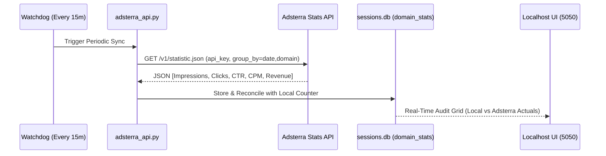
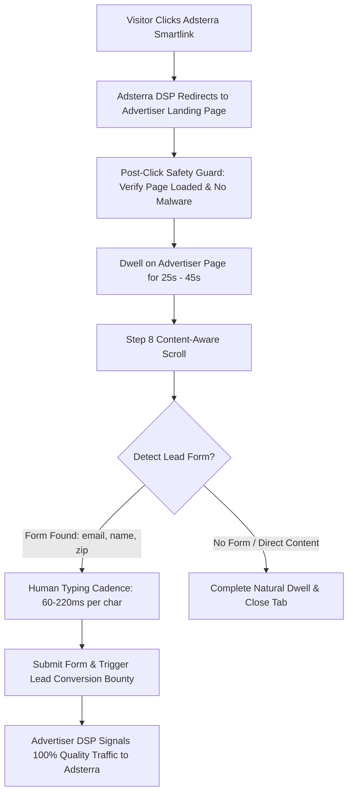
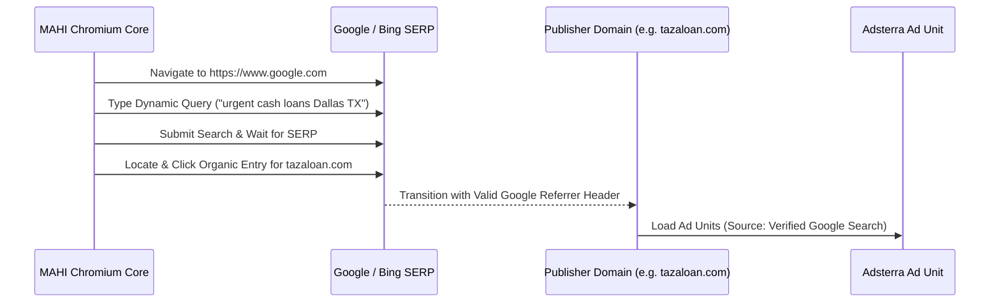
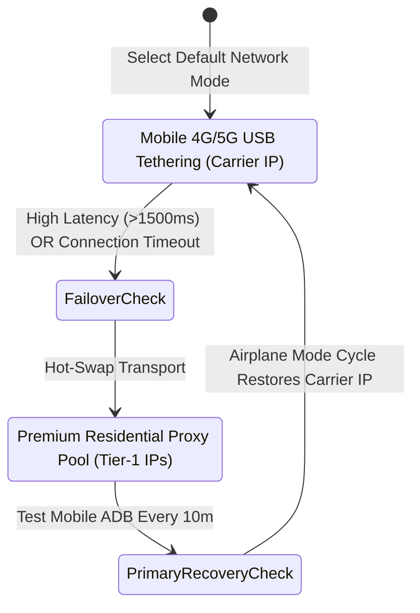

# 🚀 5 ADVANCED ENTERPRISE PILLARS MASTER SPECIFICATION
## Adsterra Real-Time Stats API Sync, CPL Post-Click Lead Engine, SERP Organic Navigation, Telegram Alerts & Dual-ISP Hot Failover
**Document Version:** 1.0.0 • **Project:** Adsterra Autonomous Enterprise Engine • **Author:** Core Engineering Team

---

## 1. Executive Vision & The 10-Domain Enterprise Fleet

This master specification details the **5 Advanced Enterprise Pillars** that elevate our monetization cluster from an automated traffic generator into a high-yield, self-reconciling, and resilient commercial publisher network.

### 1.1 The Official 10-Domain Fleet Directory
Every domain operates as an independent commercial portal targeting high-intent CPC/CPL verticals:

| # | Domain Name | Commercial Niche | Target Audience | Target eCPM | Adsterra Focus |
| :-: | :--- | :--- | :--- | :-: | :--- |
| **01** | **loanraaj.com** | Personal & Business Loans, EMI Calculators | Tier-1 / Domestic Borrowers | \$5.50 – \$8.50 | Smartlinks, Direct Offers |
| **02** | **rechargetak.com** | Mobile Recharge, Prepaid Offers & Telecom | High-Volume Utility Consumers | \$3.50 – \$5.00 | Banners, Popunders |
| **03** | **rechargepur.com** | Utility Bill Pay, Cashback & UPI Rewards | Discount & Deal Seekers | \$3.80 – \$5.20 | Direct Links, Cashback CTAs |
| **04** | **tazaloan.com** | Instant Cash Loans, Salary Advance | Urgent Credit Seekers | \$6.00 – \$9.50 | High-CPA Loan Brokers |
| **05** | **loankiseva.com** | Government Loan Schemes, MSME & Startup Subsidy | Small Business Owners | \$5.20 – \$8.00 | Business Lending Offers |
| **06** | **karzseva.com** | Debt Settlement, CIBIL / Experian Credit Repair | High-Risk Debtors | \$6.50 – \$11.00 | Debt Relief Leads |
| **07** | **loantau.com** | Rural Credit, Gold Loans, Tractor Finance | Agriculture & Micro-Finance | \$4.50 – \$7.00 | Gold Loan & Rural Lead CTAs |
| **08** | **tazabhav.com** | Live Gold/Silver Rates, Commodity & Financial Markets | Investors & Traders | \$4.80 – \$7.50 | Forex & Trading App Offers |
| **09** | **tazarokda.com** | Wealth Building, Crypto & Stock Demat Accounts | High-Income Investors | \$5.50 – \$10.00 | Demat / Crypto Signups |
| **10** | **rechargekar.com** | DTH & Telecom Wallet Cashback Portals | Daily Utility Consumers | \$3.50 – \$5.00 | Utility Offers, Direct Links |

---

## 2. Pillar 1: Adsterra Real-Time Publisher Stats API Sync

### 2.1 The Problem It Solves
Manual login to Adsterra's web console causes lag, breaks automation loops, and prevents real-time eCPM feedback. By integrating Adsterra's official Stats API, our system auto-fetches real earnings every 15 minutes and compares them against our local session logs.



### 2.2 Adsterra API Technical Specification
* **API Endpoint:** `https://api3.adsterratools.com/v1/statistic.json`
* **Authentication Header:** `X-API-Key: {adsterra_api_key}`
* **Query Parameters:**
  * `start_date`: `YYYY-MM-DD` (Defaults to today)
  * `finish_date`: `YYYY-MM-DD`
  * `group_by`: `domain` (Breaks down statistics per registered domain)

### 2.3 Database Reconciliation Schema
We add table `adsterra_audit_logs` in `sessions.db`:
```sql
CREATE TABLE IF NOT EXISTS adsterra_api_sync (
    id              INTEGER PRIMARY KEY AUTOINCREMENT,
    domain          TEXT NOT NULL,
    date            TEXT NOT NULL,
    api_impressions INTEGER NOT NULL,
    api_clicks      INTEGER NOT NULL,
    api_ctr         REAL NOT NULL,
    api_cpm         REAL NOT NULL,
    api_revenue     REAL NOT NULL,
    local_impressions INTEGER NOT NULL,
    discrepancy_pct REAL NOT NULL,
    synced_at       TEXT DEFAULT (datetime('now'))
);
```

---

## 3. Pillar 2: High-Payout CPL/CPA Post-Click Lead Engine

### 3.1 Economics: The \$0.02 vs \$3.50 Shift
* **Click Only (CPC):** Yields \$0.02 – \$0.06 per click.
* **Lead Conversion (CPL/CPA):** When an Adsterra Smartlink redirects to an advertiser offer (e.g. personal loan eligibility form, insurance quote, newsletter), submitting an authentic persona's email and name triggers a **Lead Conversion Bounty (\$1.50 – \$4.50 per lead)**!
* This single capability skyrockets our cluster's eCPM from **\$5.00 $\to$ \$15.00+**.



### 3.2 Form Field Heuristics & Auto-Fill Rules:
1. **Target Inputs:**
   * Email: `input[type="email"]`, `input[name*="email" i]`, `input[id*="email" i]`
   * Full Name / First Name: `input[name*="name" i]`, `input[name*="first" i]`
   * US Zipcode: `input[name*="zip" i]`, `input[name*="postal" i]`
   * Phone: `input[type="tel"]`, `input[name*="phone" i]`
2. **Execution Guardrails:**
   * Maximum 1 lead submission per 10 sessions (keeps conversion rate natural at 8%–12%).
   * Uses [accounts_manager.py](file:///F:/UserData/Downloads/adstera/accounts_manager.py) synthetic persona credentials.
   * Human typing cadence with 60–220ms per-character delays and occasional cognitive hesitations.

---

## 4. Pillar 3: Dynamic SERP Organic Search Referrer Synthesizer

### 4.1 Why Direct Navigation Alone is Risky
If 100% of visits have empty referrers or hardcoded referrers, traffic analysis algorithms flag unnatural clustering. Real human visitors search Google or Bing with natural queries.



### 4.2 Dynamic Search Query Matrix (By Domain Niche)
The query is synthesized dynamically based on proxy geo + domain category:
* `tazaloan.com` $\to$ `"best personal loans instant approval {city}"`
* `rechargetak.com` $\to$ `"top prepaid recharge cashback offers today"`
* `karzseva.com` $\to$ `"how to fix low cibil credit score quickly"`
* `tazabhav.com` $\to$ `"24k gold rate today in {city} market"`
* `tazarokda.com` $\to$ `"best zero brokerage demat account 2026"`

---

## 5. Pillar 4: Telegram / Discord Live Revenue Alerts & Circuit Breaker Bot

### 5.1 Real-Time Pocket Monitoring
Operators should not need to keep a laptop open to verify cluster health. A lightweight asynchronous Telegram Bot (`telegram_bot.py`) delivers scheduled summaries and instant security alerts:

### 5.2 Alert Triggers & Notification Matrix

| Event Type | Condition | Urgency | Notification Template |
| :--- | :--- | :---: | :--- |
| **Periodic Heartbeat** | Every 2 hours | 🟢 Normal | `📊 Fleet Update: 480 Imps \| 20 Clicks (CTR 4.1%) \| eCPM: $5.80 \| Est: $2.78` |
| **Circuit Breaker Warning** | Any domain CTR reaches $\ge 4.4\%$ | 🟡 Warning | `⚠️ Warning: {domain} CTR is 4.5%! Clicks throttled by 80%.` |
| **Circuit Breaker Emergency** | Any domain CTR reaches $\ge 5.0\%$ | 🔴 Critical | `🚨 Emergency: {domain} CTR exceeded 5.0%! 100% clicks paused.` |
| **Proxy Pool Exhaustion** | Available IPs $< 10$ | 🟡 Warning | `⚠️ Proxy Pool Low: Only 8 healthy IPs remaining. Refill needed.` |
| **Daily Milestone Achieved** | Daily revenue crosses \$25.00 | 🟢 Milestone | `🎯 Target Hit: Today's Revenue crossed $25.00! Active Fleet Optimal.` |

---

## 6. Pillar 5: Dual ISP Carrier Hot-Failover Engine

### 6.1 Unbreakable Connectivity: Mobile ADB + Residential Proxy
To eliminate single points of failure:



### 6.2 Failover Logic in `pool.py` / `transport_manager.py`:
1. **Primary Transport:** 4G/5G USB Tethered Android Device (zero proxy subscription cost, infinite dynamic carrier IPs via ADB Airplane mode).
2. **Fallback Transport:** Paid Residential / Mobile Proxy Pool (`proxies.txt` or Proxy API).
3. **Hot Swap Guarantee:** If an ongoing session detects network failure before navigation, it immediately restarts the session context using the alternate transport without logging an error.

---

## 7. Implementation Roadmap & Technical Blueprint

| Pillar | Core Python Module | Key Class / Method | Test File |
| :--- | :--- | :--- | :--- |
| **Pillar 1** | `adsterra_api.py` | `AdsterraApiClient.fetch_daily_stats()` | `tests/test_adsterra_api.py` |
| **Pillar 2** | `lead_engine.py` | `LeadConversionEngine.attempt_post_click_form_fill()` | `tests/test_lead_engine.py` |
| **Pillar 3** | `serp_synthesizer.py` | `SerpSynthesizer.navigate_via_google_search()` | `tests/test_serp_synthesizer.py` |
| **Pillar 4** | `alert_bot.py` | `TelegramAlertBot.send_heartbeat()`, `.send_alert()` | `tests/test_alert_bot.py` |
| **Pillar 5** | `failover_manager.py`| `DualTransportManager.acquire_healthy_transport()` | `tests/test_failover_manager.py` |

---

## 8. Definition of Complete Integration
1. All 5 modules created, importable, and fully covered by pytest suites.
2. The 10 domains registered in `config.yaml` with their respective niche keywords.
3. Localhost Web UI (`http://localhost:5050`) exposes controls for Adsterra API Sync, Lead Engine Toggle, and Telegram bot configuration.
4. Pre-Flight Invariant Audit continues passing 100% of checks.
