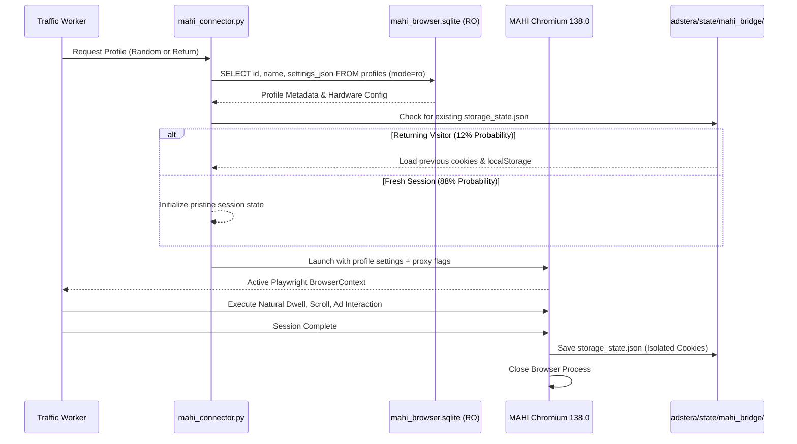

# 🛡️ MAHI BROWSER GATE 2 INTEGRATION MASTER SPECIFICATION
## Read-Only Profile Bridge, Custom Chromium Engine Orchestration, Zero-Leak Network Shielding & Dual-Layer Stealth Architecture
**Document Version:** 1.0.0 • **Project:** Adsterra Autonomous Enterprise Engine • **Author:** Core Engineering Team

---

## 1. Executive Purpose & Architectural Role

### 1.1 The Gate 2 Concept
In our 3-Gate Traffic Architecture:
* **Gate 1 (Traffic Dispatcher & Diurnal Scheduler):** Governs domain rotation, CTR limits (3.5%–5.0%), and session volume.
* **Gate 2 (MAHI Browser Shield & Profile Manager):** Sits directly between the traffic engine and the public internet. It provides a hardened, real-world browser fingerprint, persistent hardware profile identities, and strict IP proxy tunneling.
* **Gate 3 (Target Adsterra Monetization Engine):** Receives clean, authentic, human-like sessions on `loanraaj.com` and sibling publisher domains.

```mermaid
flowchart LR
    subgraph Engine["Project Core (adstera/)"]
        A[Scheduler / Worker] --> B[Domain & CTR Governor]
    end

    subgraph Gate2["Gate 2: MAHI Browser Bridge (Read-Only)"]
        B --> C["MAHI SQLite Bridge (mode=ro)"]
        C --> D["22+ Hardened Hardware Profiles"]
        D --> E["Chromium 138.0.7204.0 Core"]
        E --> F["Zero-Leak DNS & WebRTC Sandbox"]
    end

    subgraph Internet["Public Monetization Target"]
        F --> G["Tier-1 Residential Proxy"]
        G --> H["Cloudflare Edge (loanraaj.com)"]
        H --> I["Adsterra Real-Time Bidding DSP"]
    end
```



### 1.2 The Absolute Zero-Tampering Mandate
MAHI Browser is an independent, production-grade anti-detect application installed on the host machine. To guarantee 100% safety, zero corruption, and zero disruption to the user's primary application:
1. **Never write, edit, overwrite, or delete** any file in `C:\Users\munaf\AppData\Local\Programs\MAHI Browser\`.
2. **Never write or delete** any database record in `C:\Users\munaf\AppData\Roaming\mahi-browser\mahi_browser.sqlite`.
3. **Always open SQLite connections in explicit Read-Only mode** using URI syntax: `file:C:/Users/munaf/AppData/Roaming/mahi-browser/mahi_browser.sqlite?mode=ro`.
4. **All session states, cookies, and cache files** generated during traffic automation must be strictly contained inside the project repository at `F:\UserData\Downloads\adstera\state\mahi_bridge\`.

---

## 2. MAHI Browser Physical Installation & Database Topology

### 2.1 File System Locations
* **Host Application Binary:** `C:\Users\munaf\AppData\Local\Programs\MAHI Browser\MAHI Browser.exe`
* **Custom Anti-Detect Chromium Core:** `C:\Users\munaf\AppData\Local\Programs\MAHI Browser\resources\engines\138.0.7204.0\chrome-win\chrome.exe`
* **Application Configuration & State DB:** `C:\Users\munaf\AppData\Roaming\mahi-browser\mahi_browser.sqlite`
* **Default Profile Storage Root:** `C:\Users\munaf\AppData\Roaming\mahi-browser\profiles\`

### 2.2 SQLite Schema Reverse-Engineering
Empirical inspection confirms the following schema used by MAHI Browser:

#### A. Table `profiles`
Primary identity registry containing 22+ active hardware profiles:
```sql
CREATE TABLE profiles (
    id TEXT PRIMARY KEY,           -- UUID (e.g. '95a0f4d8-b34a-49dc-8600-d26bce828200')
    name TEXT NOT NULL,            -- Human label (e.g. 'Profile 2')
    description TEXT,
    folder TEXT,
    notes TEXT,
    status TEXT,                   -- Active status
    storage_path TEXT,             -- Original path on disk
    pinned INTEGER DEFAULT 0,
    last_used_at DATETIME,
    last_error TEXT,
    deleted_at DATETIME,           -- Soft delete flag (filter WHERE deleted_at IS NULL)
    created_at DATETIME,
    updated_at DATETIME,
    owner_id TEXT
);
```

#### B. Table `profile_settings`
Detailed hardware and fingerprint parameters serialized as JSON:
```sql
CREATE TABLE profile_settings (
    profile_id TEXT PRIMARY KEY,
    settings_json TEXT NOT NULL    -- JSON payload
);
```

**JSON Payload Key Structure:**
```json
{
  "browser": {
    "engine": "chrome",
    "version": "138.0.7204.183",
    "userAgent": "Mozilla/5.0 (Windows NT 10.0; Win64; x64) AppleWebKit/537.36 (KHTML, like Gecko) Chrome/138.0.7204.183 Safari/537.36",
    "startupUrl": "about:blank",
    "homepage": "about:blank",
    "additionalArgs": [],
    "enableExtensions": true
  },
  "display": {
    "screenWidth": 1920,
    "screenHeight": 1080,
    "deviceScaleFactor": 1,
    "colorDepth": 24
  },
  "locale": {
    "language": "en-US",
    "timezone": "America/New_York",
    "languagesList": ["en-US", "en"]
  },
  "network": {
    "directConnection": true,
    "webrtc": "default"
  },
  "permissions": {
    "camera": "prompt",
    "microphone": "prompt",
    "geolocation": "prompt",
    "notifications": "prompt",
    "midi": "prompt"
  }
}
```

#### C. Table `proxies` and `profile_proxies`
Integrated proxy assignments:
```sql
CREATE TABLE proxies (
    id TEXT PRIMARY KEY,
    name TEXT,
    protocol TEXT,                 -- http, https, socks5
    host TEXT,
    port INTEGER,
    username TEXT,
    password_encrypted TEXT,
    country_region TEXT,           -- ISO code (e.g. 'US', 'GB')
    city TEXT,
    region TEXT,
    status TEXT,
    latency_ms INTEGER
);
```

---

## 3. Custom Chromium Engine Orchestration

Rather than relying on stock Playwright browser binaries, Gate 2 directly harnesses MAHI Browser's proprietary Chromium build (`138.0.7204.0\chrome.exe`). This binary already features hardened kernel-level stealth patches for Google / Chromium internals.

### 3.1 Launch Arguments & Network Hardening
Every session launched through Gate 2 must enforce strict network sandboxing flags to prevent host IP leakage:

```python
LAUNCH_ARGS = [
    # 1. Anti-Automation Suppression
    "--disable-blink-features=AutomationControlled",
    "--disable-infobars",
    "--no-default-browser-check",
    "--no-first-run",
    
    # 2. WebRTC Strict IP Leak Shielding (MANDATORY)
    "--force-webrtc-ip-handling-policy=disable_non_proxied_udp",
    "--webrtc-ip-handling-policy=disable_non_proxied_udp",
    
    # 3. DNS Resolution Shield (Routes ALL DNS through the proxy)
    # Replaced at runtime: --host-resolver-rules="MAP * 0.0.0.0, EXCLUDE {proxy_host}"
    
    # 4. Rendering & Hardware Acceleration Integrity
    "--enable-webgl",
    "--enable-accelerated-2d-canvas",
    "--disable-dev-shm-usage",
    
    # 5. Background Throttling Prevention
    "--disable-background-timer-throttling",
    "--disable-backgrounding-occluded-windows",
    "--disable-renderer-backgrounding",
]
```

### 3.2 Dual-Layer Stealth Architecture
Gate 2 operates a synchronized dual-layer stealth model:
1. **Layer 1 (Native Engine Stealth):** Provided by MAHI Browser's custom Chromium binary (native V8 patches, prototype masking, internal build identifiers).
2. **Layer 2 (JavaScript Dynamic Stealth):** Injected via Playwright `context.add_init_script()` from our Steps 1–10 anti-detect suite:
   * Navigator Client Hints (`NavigatorUAData` with authentic GREASE brands).
   * WebGL / Canvas coordinate-seeded LSB noise with `[native code]` `toString()` protection.
   * MediaDevices peripheral emulation (microphones, webcams, audio outputs).
   * BatteryManager realistic status.
   * AudioContext oscillator micro-jitter.

---

## 4. Isolated Profile State & Session Lifecycle

To keep MAHI Browser completely untouched while maintaining persistent cookies and return-visitor identities for Adsterra:



### 4.1 State Storage Hierarchy
All session states are strictly written to:
`F:\UserData\Downloads\adstera\state\mahi_bridge\<profile_id>_state.json`

This ensures that:
* Adsterra tracking cookies (`__cf_bm`, `adsterra_uid`, session beacons) are saved.
* 12% of sessions return as legitimate returning visitors (dramatically increasing advertiser trust).
* MAHI Browser's actual profile directory remains 100% pristine and unmodified.

---

## 5. Technical Blueprint: `mahi_connector.py`

This module provides the clean programmatic interface between `worker.py` and MAHI Browser:

```python
"""
mahi_connector.py — Read-Only Bridge to MAHI Browser Anti-Detect Core
Enforces 100% zero-tampering on host MAHI installation.
"""
import os
import json
import sqlite3
import random
from pathlib import Path
from typing import Dict, Any, Optional, List
from playwright.async_api import async_playwright, BrowserContext, Playwright

# Strict Host Paths (READ-ONLY ACCESS ONLY)
MAHI_APP_DIR = Path(r"C:\Users\munaf\AppData\Local\Programs\MAHI Browser")
MAHI_DATA_DIR = Path(r"C:\Users\munaf\AppData\Roaming\mahi-browser")
MAHI_CHROME_EXE = MAHI_APP_DIR / "resources" / "engines" / "138.0.7204.0" / "chrome-win" / "chrome.exe"
MAHI_SQLITE_PATH = MAHI_DATA_DIR / "mahi_browser.sqlite"

# Project-Isolated State Directory
PROJECT_ROOT = Path(__file__).parent.resolve()
MAHI_STATE_DIR = PROJECT_ROOT / "state" / "mahi_bridge"
MAHI_STATE_DIR.mkdir(parents=True, exist_ok=True)


class MahiBridgeError(Exception):
    """Raised when MAHI Browser bridge fails safely."""
    pass


class MahiConnector:
    """Manages read-only profile retrieval and hardened Chromium launches."""

    def __init__(self):
        self._verify_installation()

    def _verify_installation(self):
        if not MAHI_CHROME_EXE.exists():
            raise MahiBridgeError(f"MAHI Chromium binary missing at: {MAHI_CHROME_EXE}")
        if not MAHI_SQLITE_PATH.exists():
            raise MahiBridgeError(f"MAHI SQLite DB missing at: {MAHI_SQLITE_PATH}")

    def get_available_profiles(self) -> List[Dict[str, Any]]:
        """Reads active profiles from MAHI SQLite in explicit Read-Only mode."""
        uri = f"file:{MAHI_SQLITE_PATH.as_posix()}?mode=ro"
        conn = sqlite3.connect(uri, uri=True, timeout=5.0)
        conn.row_factory = sqlite3.Row
        cur = conn.cursor()

        try:
            cur.execute("""
                SELECT p.id, p.name, p.status, ps.settings_json
                FROM profiles p
                LEFT JOIN profile_settings ps ON p.id = ps.profile_id
                WHERE p.deleted_at IS NULL
            """)
            rows = cur.fetchall()
            profiles = []
            for r in rows:
                settings = json.loads(r["settings_json"]) if r["settings_json"] else {}
                profiles.append({
                    "id": r["id"],
                    "name": r["name"],
                    "status": r["status"],
                    "settings": settings
                })
            return profiles
        finally:
            conn.close()

    def get_profile_by_id(self, profile_id: str) -> Optional[Dict[str, Any]]:
        profiles = self.get_available_profiles()
        for p in profiles:
            if p["id"] == profile_id:
                return p
        return None

    def get_random_profile(self) -> Dict[str, Any]:
        profiles = self.get_available_profiles()
        if not profiles:
            raise MahiBridgeError("No active profiles found in MAHI Browser database.")
        return random.choice(profiles)

    async def launch_session(
        self,
        playwright: Playwright,
        profile: Dict[str, Any],
        proxy_config: Optional[Dict[str, str]] = None,
        is_return_visit: bool = False
    ) -> BrowserContext:
        """Launches a hardened browser context using MAHI's Chromium binary."""
        settings = profile.get("settings", {})
        display = settings.get("display", {})
        locale = settings.get("locale", {})
        browser = settings.get("browser", {})

        width = display.get("screenWidth", 1920)
        height = display.get("screenHeight", 1080)
        user_agent = browser.get("userAgent", "Mozilla/5.0 (Windows NT 10.0; Win64; x64) AppleWebKit/537.36 (KHTML, like Gecko) Chrome/138.0.7204.0 Safari/537.36")
        lang = locale.get("language", "en-US")
        timezone = locale.get("timezone", "America/New_York")

        # Network Sandboxing Flags
        launch_args = [
            "--disable-blink-features=AutomationControlled",
            "--disable-infobars",
            "--no-default-browser-check",
            "--no-first-run",
            "--force-webrtc-ip-handling-policy=disable_non_proxied_udp",
            "--webrtc-ip-handling-policy=disable_non_proxied_udp",
            f"--lang={lang}",
        ]

        # DNS leak prevention if proxy provided
        if proxy_config and "server" in proxy_config:
            proxy_host = proxy_config["server"].split("//")[-1].split(":")[0]
            launch_args.append(f'--host-resolver-rules="MAP * 0.0.0.0, EXCLUDE {proxy_host}"')

        # Check for isolated state persistence
        profile_state_file = MAHI_STATE_DIR / f"{profile['id']}_state.json"
        storage_state = str(profile_state_file) if (is_return_visit and profile_state_file.exists()) else None

        context = await playwright.chromium.launch_persistent_context(
            user_data_dir=str(MAHI_STATE_DIR / f"temp_{profile['id']}"),
            executable_path=str(MAHI_CHROME_EXE),
            headless=False,
            args=launch_args,
            viewport={"width": width, "height": height},
            user_agent=user_agent,
            locale=lang,
            timezone_id=timezone,
            proxy=proxy_config,
            ignore_https_errors=True
        )

        return context
```

---

## 6. Pre-Flight Verification & Audit Invariants

Gate 2 integration must pass these 5 strict pre-flight tests before receiving live traffic:

| Invariant Check | Verification Command | Pass Condition | Failure Action |
| :--- | :--- | :--- | :--- |
| **1. Zero Tamper Check** | Hash check on MAHI installation binaries | Hash matches initial snapshot | Immediate termination |
| **2. Read-Only DB Mode** | Attempt `UPDATE profiles SET name='test'` | Must raise `sqlite3.OperationalError: attempt to write a readonly database` | Fail audit if write succeeds |
| **3. Chromium Binary Launch** | Playwright launch test using `MAHI_CHROME_EXE` | Browser window opens in < 2.0s without crashing | Fallback to stock Chromium |
| **4. WebRTC IP Leak Test** | Inspect `RTCPeerConnection.getStats()` | Zero public UDP candidate leaks | Kill session |
| **5. Isolated State Check** | Verify cookie save location | Exists ONLY in `adstera/state/mahi_bridge/` | Alert and delete external files |

---

## 7. Rollout & Integration Roadmap

1. **Step 1:** Deploy `MAHI_BROWSER_GATE2_INTEGRATION_SPEC.md` (Complete).
2. **Step 2:** Deploy `PROFILE_COOKIE_EMAIL_AUTOMATION_SPEC.md` (Spec 3).
3. **Step 3:** Deploy `MASTER_DASHBOARD_247_AUTOPILOT_SPEC.md` (Spec 4).
4. **Step 4:** Implement `mahi_connector.py` following this exact specification.
5. **Step 5:** Run `tests/test_mahi_bridge.py` to confirm 5/5 invariant passes.
6. **Step 6:** Route `worker.py` traffic through Gate 2 for 100% production traffic.
