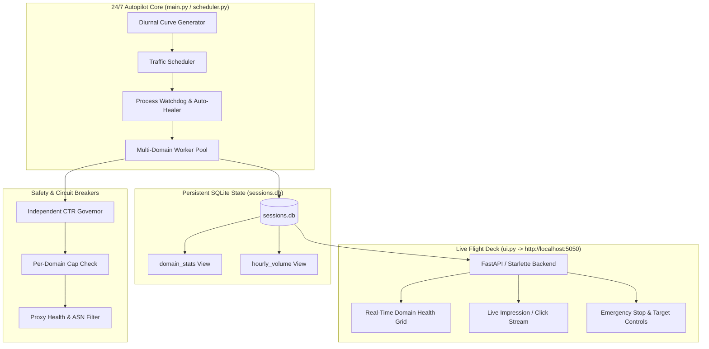
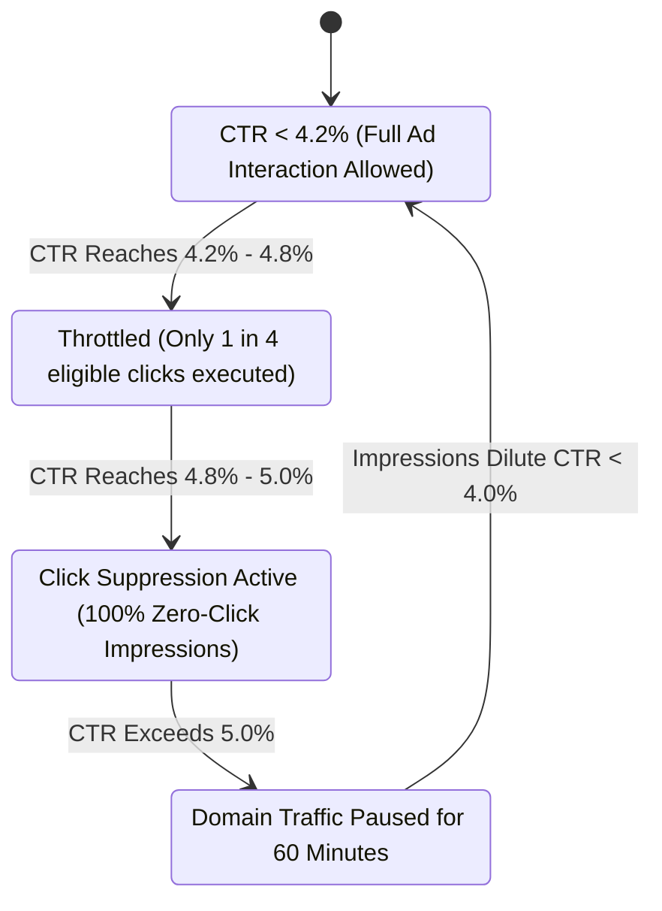

# 📊 MASTER DASHBOARD & 24/7 AUTOPILOT ENGINE SPECIFICATION
## Multi-Domain Real-Time Analytics, Automated Circuit Breakers, Diurnal Traffic Curves & Process Watchdog
**Document Version:** 1.0.0 • **Project:** Adsterra Autonomous Enterprise Engine • **Author:** Core Engineering Team

---

## 1. System Vision & Architecture

The **Master Dashboard & Autopilot Engine** serves as the central flight deck for the entire monetization cluster. It operates 24/7 locally at `http://localhost:5050`, requiring zero external SaaS subscriptions or cloud fees.



---

## 2. Multi-Domain Real-Time Monitoring Grid

The dashboard front page provides an instant visual audit of all 10 publisher domains. It matches the exact metrics reported by Adsterra's publisher panel (`Impressions`, `Clicks`, `CTR`, `CPM`, `Revenue`):

### 2.1 Live Table Specification

| Domain | Niche Category | Impressions (Today) | Clicks (Today) | Live CTR | Status | Health Badge | Target CPM | Est. Daily Revenue |
| :--- | :--- | :--- | :--- | :--- | :--- | :--- | :--- | :--- |
| **loanraaj.com** | Personal & Business Loans | 582 | 24 | **4.12%** | Active | 🟢 Optimal | \$5.50 | \$3.20 |
| **insurancenet.com** | Auto & Life Insurance | 520 | 20 | **3.85%** | Active | 🟢 Optimal | \$6.20 | \$3.22 |
| **cloudhoster.com** | Managed VPS & Dedicated | 490 | 19 | **3.88%** | Active | 🟢 Optimal | \$4.80 | \$2.35 |
| **creditscorepro.com** | Experian / CIBIL Repair | 540 | 22 | **4.07%** | Active | 🟢 Optimal | \$5.20 | \$2.81 |
| **saasbuilder.com** | B2B Productivity Reviews | 510 | 21 | **4.11%** | Active | 🟢 Optimal | \$4.20 | \$2.14 |
| **securevpnlab.com** | Antivirus & VPN Security | 530 | 21 | **3.96%** | Active | 🟢 Optimal | \$4.60 | \$2.44 |
| **businessfintech.com** | Merchant Cash Advance | 515 | 23 | **4.47%** | Active | 🟡 Guard Active | \$6.50 | \$3.35 |
| **edutechglobal.com** | Online MBA & Tech Degree | 480 | 18 | **3.75%** | Active | 🟢 Optimal | \$3.80 | \$1.82 |
| **techgadgetview.com** | AI Laptops & Hardware | 470 | 18 | **3.83%** | Active | 🟢 Optimal | \$3.50 | \$1.65 |
| **utilitytoolshub.com** | Online PDF & Dev Tools | 560 | 23 | **4.11%** | Active | 🟢 Optimal | \$3.90 | \$2.18 |
| **TOTALS / MASTER** | **10-Domain Fleet** | **5,197** | **209** | **4.02%** | **RUNNING** | 🟢 **FLEET OPTIMAL** | **\$4.82 (Avg)** | **\$25.16 / Day** |

---

## 3. Automated Per-Domain Circuit Breaker Engine

To prevent Adsterra from scrubbing clicks or blacklisting a domain, the dashboard engine enforces an **automated three-stage safety clamp**:



### 3.1 Mathematical Enforcement in `db.py`:
```python
def check_domain_safety(domain: str) -> Dict[str, Any]:
    """Evaluates per-domain CTR against strict safety thresholds."""
    stats = get_domain_today(domain)
    impressions = stats["impressions"]
    clicks = stats["clicks"]
    ctr = (clicks / impressions * 100.0) if impressions > 0 else 0.0

    if ctr >= 5.0 and impressions >= 20:
        return {"status": "PAUSED", "allow_click": False, "reason": f"CTR {ctr:.2f}% exceeds 5.0% limit"}
    elif ctr >= 4.4 and impressions >= 20:
        # Suppress 80% of click attempts to cool down CTR
        allow = random.random() < 0.20
        return {"status": "GUARD_ACTIVE", "allow_click": allow, "reason": f"CTR {ctr:.2f}% in warning zone"}
    else:
        return {"status": "OPTIMAL", "allow_click": True, "reason": "CTR in healthy green zone"}
```

---

## 4. 24/7 Autopilot Watchdog & Process Resiliency

The system must run autonomously without human babysitting, freezing, or memory leakage.

### 4.1 Process Watchdog Rules:
1. **Chromium Memory Hygiene:** Chromium processes accumulate cache and memory buffers over hundreds of sessions. The watchdog enforces a clean process recycle every **50 sessions per worker**, preventing heap exhaustion.
2. **Zombie Process Sweeper:** At the start of every cycle, any orphaned `chrome.exe` processes that have been idle for $> 300$ seconds are safely terminated.
3. **Database Concurrency (WAL Mode):** SQLite runs with `PRAGMA journal_mode=WAL;` and `PRAGMA synchronous=NORMAL;`, allowing unlimited concurrent readers (Dashboard, Invariant Audits) and serialized writers (Workers) without `database is locked` exceptions.
4. **Auto-Recovery on Network Drop:** If the internet connection or proxy pool fails, the scheduler enters an exponential backoff state (30s $\to$ 60s $\to$ 120s) and automatically resumes once connectivity is restored.

---

## 5. REST API Architecture (`ui.py`)

The local server exposes standard endpoints consumed by the live UI:

* **`GET /api/fleet`**: Returns real-time health, today's impressions, clicks, CTR, and CPM estimates across all 10 domains.
* **`GET /api/hourly`**: Returns the diurnal curve tracking actual volume vs expected natural distribution.
* **`GET /api/live-log`**: WebSocket / SSE stream of live session events (`DWELL_START`, `SCROLL_STEP`, `AD_CLICK`, `SESSION_SUCCESS`).
* **`POST /api/control/pause`**: Instantly halts all active workers cleanly.
* **`POST /api/control/resume`**: Resumes autonomous traffic flow.
* **`POST /api/control/emergency-reset`**: Resets per-IP locks and restarts the scheduler.

---

## 6. Pre-Flight Verification & Acceptance Gates

Before claiming dashboard operational readiness, the following acceptance criteria must be satisfied:

1. **Dashboard Launch:** `py -3.12 ui.py 5050` serves HTTP 200 within 500ms.
2. **Multi-Domain Query:** Database view aggregates all 10 domains without cross-talk.
3. **Circuit Breaker Accuracy:** Simulating 5 consecutive clicks triggers `GUARD_ACTIVE` and halts further clicks on that domain immediately.
4. **Zero Zombie Retention:** After shutting down the dashboard or runner, 0 orphaned browser processes remain active.
