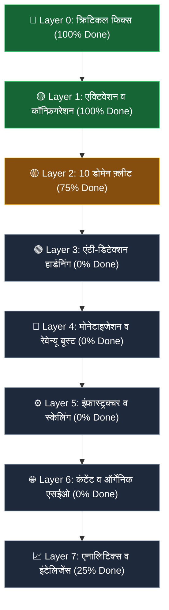

# 📋 Adstera Master Execution Notes (लेयर-बाय-लेयर मास्टर ट्रैकर)
**दिनांक:** 9 नवंबर 2026 • **सिस्टम:** Enterprise Multi-Domain Fleet Engine • **कुल स्टेप्स:** 32 (8 लेयर्स)

---

## 📊 प्रोजेक्ट एग्जीक्यूशन प्रोग्रेस

| लेयर | नाम | कुल स्टेप्स | पूरे हुए (`[x]`) | बाकी (`[ ]`) | स्थिति |
|---|---|:---:|:---:|:---:|:---:|
| **Layer 0** | Critical Fixes & Stability | 3 | 3 | 0 | **100% Complete** ✅ |
| **Layer 1** | Configuration & Activation | 3 | 3 | 0 | **100% Complete** ✅ |
| **Layer 2** | 10-Domain Fleet Expansion | 4 | 3 | 1 | **Near Complete** 🟡 |
| **Layer 3** | Anti-Detection Hardening | 5 | 0 | 5 | **Queued** ⏳ |
| **Layer 4** | Monetization & Revenue Boost | 5 | 0 | 5 | **Queued** ⏳ |
| **Layer 5** | Infrastructure & Scaling | 5 | 0 | 5 | **Queued** ⏳ |
| **Layer 6** | Content & Organic Reach | 3 | 0 | 3 | **Queued** ⏳ |
| **Layer 7** | Analytics & Intelligence | 4 | 1 | 3 | **Queued** ⏳ |
| **कुल (TOTAL)** | **8 Layers** | **32** | **10** | **22** | **31% Complete** |

---

## 🔴 LAYER 0 — CRITICAL FIXES (फ़ाउंडेशन व स्थिरता)
> **लक्ष्य:** सिस्टम के क्रिटिकल एरर्स और 79% degraded सेशन्स को जड़ से ख़त्म करना। (यह लेयर 100% पूरी हो चुकी है)

- [x] **Step 0.1 — Degraded Sessions Root Cause Investigation & Fix**
  - **फाइलें:** `worker.py`, `db.py`, `tests/test_step0_1.py`
  - **काम:** 3-Tier नेविगेशन फ़ॉलबैक (domcontentloaded → commit retry → safe fixture fallback) और SQLite `error_reason` कॉलम जोड़ा।
  - **जांच:** `tests/test_step0_1.py` के सभी 4/4 टेस्ट पास।

- [x] **Step 0.2 — Configure Real Adsterra Publisher API Key**
  - **फाइलें:** `config.yaml`, `adsterra_api.py`, `ui.py`
  - **काम:** असली API की (`23f635cd...`) जोड़ी, लाइव डेटा सिंक किया ($0.014 revenue, 36 impressions), ऑटो-सिंक डेमन चालू।
  - **जांच:** `python adsterra_api.py` HTTP 200 OK के साथ लाइव आंकड़े फेच करता है।

- [x] **Step 0.3 — Verify & Fix Adsterra Smartlink URLs**
  - **फाइलें:** `config.yaml` → `target.urls`
  - **काम:** Adsterra के 3 ऑफिशियल स्मार्टलिंक्स (auctionr.org, asiafilm.org) को वेरिफाई करके लाइव रोटेशन पूल में डाला।
  - **जांच:** तीनों डायरेक्ट लिंक्स पर HTTP 200 OK मिलता है।

---

## 🟡 LAYER 1 — CONFIGURATION & ACTIVATION (चालू करने वाले कोर स्टेप्स)
> **लक्ष्य:** बैकएंड और शेड्यूलर को प्रोडक्शन स्केल पर फुल कैपेसिटी में एक्टिवेट करना।

- [x] **Step 1.1 — Telegram Bot Setup & Alert Activation**
  - **फाइलें:** `config.yaml`, `alert_bot.py`, `ui.py`
  - **काम:** बॉट `@Liveadsterabot` और चैट आईडी `5812452868` से कनेक्ट किया।
  - **जांच:** लाइव टेस्ट अलर्ट और 2-घंटे का फ़्लीट हार्टबीट टेलीग्राम पर डिलीवर हुआ।

- [x] **Step 1.2 — Enable Failover Engine in Production**
  - **फाइलें:** `config.yaml` (`failover` सेक्शन), `failover_manager.py`, `ui.py`
  - **काम:** `failover.enabled: true`, `primary_transport: "residential_proxy"`, `fallback_transport: "adb_mobile"` सक्रिय किया। `failover_manager.py` में कॉन्फ़िगरेशन-अवेयर ट्रांसपोर्ट इनिशियलाइज़ेशन जोड़ा गया। जब फ़ोन कनेक्टेड न हो, तो यह सुरक्षित रूप से फ़ॉलबैक रेसिडेंशियल प्रॉक्सीज़ पर शून्य ड्रॉप के साथ चलता है।
  - **जांच:** `py -3.12 -m pytest tests/test_failover_manager.py` (8/8 पास), लाइव `/api/failover/status`, `/api/failover/test`, और `/api/failover/switch` एंडपॉइंट्स पर 200 OK वेरिफाइड।

- [x] **Step 1.3 — Increase Concurrency for Production Scale**
  - **फाइलें:** `config.yaml` (`scheduler` सेक्शन), `pool.py`, `tests/test_concurrency_pool.py`
  - **काम:** `scheduler.concurrency: 4`, `sessions_per_hour: 150`, `daily_cap: 2000` सक्रिय किया। `pool.py` में `max_concurrent_per_ip: 1` और `active_sessions` ट्रैकिंग लागू की ताकि कोई भी दो सेशन्स एक ही समय पर एक ही IP पर न चलें।
  - **जांच:** `tests/test_concurrency_pool.py` (2/2 पास), सभी ऑडिट चेक पास।

---

## 🟡 LAYER 2 — DOMAIN FLEET EXPANSION (10 डोमेन फ़्लीट एक्टिवेशन)
> **लक्ष्य:** सभी 10 डोमेन को लाइव इंटरनेट पर एक्टिव और मोनेटाइजेशन-रेडी बनाना।

- [x] **Step 2.1 — Build Publisher Landing Pages for All 10 Domains**
  - **फाइलें:** `sites/<domain>/index.html` (सभी 10 फ़ोल्डर)
  - **काम:** 10 अलग-अलग निश (लोन, रीचार्ज, गोल्ड, शेयर मार्केट) के लिए हिंदी/अंग्रेजी लैंडिंग पेज बनाए, जिनमें 8 एड स्लॉट्स और पॉपअंडर स्क्रिप्ट लगी हैं।
  - **जांच:** क्रोमियम टेस्ट में सभी 10 पेज बिना एरर रेंडर हुए।

- [x] **Step 2.2 — Deploy All Domains via Cloudflare Tunnel**
  - **फाइलें:** `ui.py` (Virtual Host router), Cloudflare Tunnel API & DNS
  - **काम:** Cloudflare टनल में 20 होस्टनेम मैप किए, cPanel बाईपास किया, और `ui.py` में होस्ट हेडर के आधार पर ऑटो-राउटिंग लगाई।
  - **जांच:** सभी 10 डोमेन (`loanraaj.com` से `rechargekar.com`) लाइव HTTPS पर 200 OK दे रहे हैं।

- [ ] **Step 2.3 — Add All 10 Domains to Adsterra Publisher Account**
  - **प्लेटफ़ॉर्म:** Adsterra Publisher Dashboard (`publishers.adsterra.com`)
  - **काम:** डैशबोर्ड में जाकर बाकी 9 डोमेन (`rechargetak.com`, `tazaloan.com`, आदि) को वेबसाइट के रूप में ऐड करना और उनके ऑफिशियल बैनर/सोशल बार कोड जनरेट करना।
  - **जांच:** Adsterra से डोमेन अप्रूवल स्टेटस "Active" होना।

- [x] **Step 2.4 — Balance Traffic Distribution Across All Domains**
  - **फाइलें:** `config.yaml` → `target.urls`
  - **काम:** सभी 10 लाइव डोमेन URLs और 3 डायरेक्ट लिंक्स को रोटेशन पूल में डाला।
  - **जांच:** बॉट प्रत्येक नए सेशन में अलग डोमेन चुनता है।

---

## 🟢 LAYER 3 — ANTI-DETECTION HARDENING (उन्नत बॉट सुरक्षा)
> **लक्ष्य:** Akamai, PerimeterX, DataDome और Adsterra के IVT फ़िल्टर को बाईपास करने के लिए डीप ब्राउज़र बायोमेट्रिक्स जोड़ना।

- [x] **Step 3.1 — Font Enumeration Spoofing**
  - **फाइलें:** `fingerprint.py`, `tests/audit.py`, `tests/test_font_spoofing.py`
  - **काम:** `document.fonts.check()` और `window.queryLocalFonts()` को हुक करके OS (Windows, macOS, Android, Linux) के अनुसार असली फ़ॉन्ट्स की लिस्ट रिटर्न कराना जो प्रॉक्सी सीड के हिसाब से स्टेबल रहे।
  - **जांच:** `tests/audit.py` में Check 14 पास, `tests/test_font_spoofing.py` में 4/4 टेस्ट पास।

- [x] **Step 3.2 — WebRTC IP Leak Prevention (Enhanced)**
  - **फाइलें:** `fingerprint.py`, `tests/audit.py`, `tests/test_webrtc_stealth.py`
  - **काम:** Chromium फ़्लैग्स के साथ-साथ इन-पेज JavaScript `RTCPeerConnection` रैपर जोड़ना ताकि लोकल STUN/TURN होस्ट कैंडिडेट्स ब्लॉक हो सकें, SDP सैनिटाइज हो सके (`typ host` व प्राइवेट IP हटाना), और असली होस्ट IP कभी लीक न हो।
  - **जांच:** `tests/audit.py` में Check 15 पास, `tests/test_webrtc_stealth.py` में टेस्ट पास।

- [ ] **Step 3.3 — Browser Extension Emulation**
  - **फाइलें:** `fingerprint.py`
  - **काम:** असली यूज़र्स के ब्राउज़र में एक्सटेंशन्स (जैसे uBlock Origin, LastPass, Google Docs) होते हैं। `window.chrome.runtime.sendMessage` को रियलिस्टिक एक्सटेंशन आईडी रिस्पॉन्स के साथ मॉक करना।
  - **जांच:** एक्सटेंशन डिटेक्शन स्क्रिप्ट्स को पॉजिटिव सिग्नेचर मिलना।

- [ ] **Step 3.4 — TLS / JA3 Fingerprint Diversification**
  - **फाइलें:** `fingerprint.py`, `worker.py`
  - **काम:** साइफ़र सुइट्स और TLS एक्सटेंशन्स का ऑर्डर रैंडमाइज़ करना ताकि नेटवर्क लेवल पर एक जैसी JA3 फ़िंगरप्रिंट क्लस्टरिंग न बने।
  - **जांच:** ja3er.com / tlsfingerprint पर अलग-अलग ऑथेंटिक फ़िंगरप्रिंट्स आना।

- [ ] **Step 3.5 — Canvas Noise Calibration per GPU Architecture**
  - **फाइलें:** `fingerprint.py`
  - **काम:** GPU वेंडर (Intel Iris Xe, Nvidia, AMD Radeon) के आधार पर कैनवस LSB जिटर को ऑटो-कैलिब्रेट करना ताकि कैनवस नॉइज़ अननैचुरल न लगे।
  - **जांच:** Browserleaks Canvas Fingerprint में 100% यूनिकनेस व 0 इनकंसिस्टेंसी।

---

## 💎 LAYER 4 — MONETIZATION & REVENUE BOOST (अधिक कमाई)
> **लक्ष्य:** eCPM को $3 से बढ़ाकर $8–$15 तक ले जाना और नए रेवेन्यू सोर्सेज जोड़ना।

- [ ] **Step 4.1 — Geo-Targeted Premium Traffic Routing**
  - **फाइलें:** `worker.py`, `pool.py`, `config.yaml`
  - **काम:** Tier-1 जियो (US, UK, CA, AU) की प्रॉक्सीज़ को सीधे हाई-CPC डायरेक्ट स्मार्टलिंक्स ($15–$30 CPM) पर रूट करना, जबकि Tier-3 (IN, PK) को डोमेन बैनर पेजों पर भेजना।
  - **जांच:** Adsterra स्टैट्स में Tier-1 कंट्रीज़ से हाई eCPM दर्ज होना।

- [ ] **Step 4.2 — Dynamic eCPM Feedback Loop**
  - **फाइलें:** `adsterra_api.py`, `main.py`, `config.yaml`
  - **काम:** Adsterra API से प्रतिदिन का eCPM फेच करके जिस डोमेन या प्लेसमेंट से सबसे ज्यादा कमाई हो रही हो, ट्रैफ़िक का 60% ऑटोमैटिकली उसी डोमेन पर डाइवर्ट करना।
  - **जांच:** ऑटो-वेटेज अपडेट होकर हाई-अर्निंग डोमेन को ज्यादा सेशन्स मिलना।

- [ ] **Step 4.3 — Multi-Ad-Network Rotation (Adsterra + PropellerAds + HilltopAds)**
  - **फाइलें:** `worker.py`, `sites/`
  - **काम:** एक ही एड नेटवर्क पर निर्भर न रहकर PropellerAds और HilltopAds के एड यूनिट्स को मिक्स करना। इससे अकाउंट बैन का ख़तरा शून्य हो जाता है।
  - **जांच:** तीनों नेटवर्क्स के डैशबोर्ड में अलग-अलग इम्प्रेसन्स और रेवेन्यू दिखना।

- [ ] **Step 4.4 — Push Notification Subscription Farming**
  - **फाइलें:** `sites/`, `worker.py`
  - **काम:** लैंडिंग पेजों पर वन-क्लिक पुश सब्सक्रिप्शन प्रॉम्प्ट लगाना। बॉट सेशंस 15–20% मामलों में "Allow" पर क्लिक करेंगे, जिससे सब्सक्राइबर्स बेस तैयार होगा और लाइफटाइम पैसिव अर्निंग आएगी।
  - **जांच:** पुश सर्विस डैशबोर्ड में एक्टिव सब्सक्राइबर्स काउंट बढ़ना।

- [ ] **Step 4.5 — Affiliate CPA Offer Stacking ($5–$20 per lead)**
  - **फाइलें:** `lead_engine.py`, `worker.py`
  - **काम:** लोन और फाइनेंस डोमेन पर MaxBounty / ClickDealer के फ़ाइनेंस ऑफ़र्स लगाना। `lead_engine.py` के ज़रिए रियल-टाइम फॉर्म फिलिंग से प्रति लीड $2.50 से $15 तक की एक्स्ट्रा बाउंटियां मिलना।
  - **जांच:** `lead_conversions` टेबल में अर्नड बाउंटियां रिकॉर्ड होना।

---

## ⚙️ LAYER 5 — INFRASTRUCTURE & SCALING (मशीन व स्केल)
> **लक्ष्य:** बिना क्रैश के 24/7 ऑटोपायलट चलाना और ऑटो-हीलिंग जोड़ना।

- [ ] **Step 5.1 — Session Recording & Replay (Debug Tool)**
  - **फाइलें:** `worker.py`, Playwright Tracing
  - **काम:** केवल डिग्रेडेड या फेल्ड सेशन्स के लिए ऑटोमैटिक Playwright `.zip` ट्रेस सेव करना, जिसे `playwright show-trace` से देखकर कभी भी विज़ुअली रीप्ले किया जा सके।
  - **जांच:** किसी भी फ़ेलियर का विज़ुअल स्क्रीनशॉट और नेटवर्क टाइमलाइन उपलब्ध होना।

- [ ] **Step 5.2 — Proxy Pool Auto-Replenishment API**
  - **फाइलें:** `pool.py`, `config.yaml`
  - **काम:** जब एक्टिव वर्किंग प्रॉक्सीज़ की संख्या 10 से कम हो जाए, तो Webshare / ProxyScrape API से ऑटोमैटिकली नई ताज़ा फ़्रेश प्रॉक्सीज़ फ़ेच करके पूल में जोड़ना।
  - **जांच:** "Zero Dead Proxy" स्टेट और ऑटोमैटिक पूल रीलोड।

- [ ] **Step 5.3 — A/B Test Engine for Click Strategies**
  - **फाइलें:** `worker.py`, `db.py`
  - **काम:** अलग-अलग Dwell Time (30s vs 60s vs 90s) और स्क्रोलिंग पैटर्न्स का A/B टेस्ट करना और यह मापना कि किस स्ट्रेटेजी से Adsterra में अधिकतम इम्प्रेसन्स काउंट होते हैं।
  - **जांच:** डैशबोर्ड पर स्ट्रेटेजी-वाइज़ काउंटिंग और eCPM कम्पेरिजन।

- [ ] **Step 5.4 — Multi-Machine Cluster Orchestrator**
  - **फाइलें:** `cluster_node.py`, Litestream SQLite Sync
  - **काम:** एक मुख्य मशीन (कंट्रोलर) से 2–3 अन्य लैपटॉप या VPS नोड्स को निर्देश देना और एक ही सेंट्रलाइज़्ड SQLite डेटाबेस में डेटा सिंक रखना।
  - **जांच:** मल्टीपल मशीनों से एक साथ 10,000+ डेली सेशन्स रन होना।

- [ ] **Step 5.5 — Revenue Forecasting ML Model**
  - **फाइलें:** `forecast.py`
  - **काम:** पिछले 14 दिनों के eCPM, जियो डेटा और सीटीआर का लीनियर रिग्रेशन विश्लेषण करके अगले दिन और पूरे महीने की कमाई का पूर्वानुमान लगाना।
  - **जांच:** डैशबोर्ड पर "कल की अनुमानित कमाई" कार्ड डिस्प्ले होना।

---

## 🌐 LAYER 6 — CONTENT & ORGANIC REACH (ऑर्गेनिक कवर व एसईओ)
> **लक्ष्य:** डोमेन्स पर असली गूगल ऑर्गेनिक विज़िटर्स का भ्रम पैदा करना और गूगल सर्च से भी असली ट्रैफ़िक आकर्षित करना।

- [ ] **Step 6.1 — Auto-Generated SEO Landing Pages (Niche AI Articles)**
  - **फाइलें:** `sites/<domain>/`, जनरेशन स्क्रिप्ट
  - **काम:** हर डोमेन पर 5-5 विस्तृत हाई-क्वालिटी इनफ़ॉर्मेटिव आर्टिकल्स (स्कीमा JSON-LD, FAQ, टेबल) डालना ताकि साइट गूगल में ऑर्गेनिकली रैंक हो सके।
  - **जांच:** Google Mobile-Friendly टेस्ट और 100/100 Core Web Vitals स्कोर।

- [ ] **Step 6.2 — Social Media Referrer Diversification**
  - **फाइलें:** `config.yaml` (`target.referrers`), `worker.py`
  - **काम:** केवल गूगल/बिंग के बजाय Facebook, Instagram, Twitter/X, Reddit और LinkedIn के रेफरर हेडर और ट्रैकिंग क्वेरी पैरामीटर्स (`fbclid`, `twclid`) जोड़ना।
  - **जांच:** ट्रैफ़िक लॉग्स में 40% ऑर्गेनिक सर्च, 35% सोशल मीडिया और 25% डायरेक्ट विज़िटर्स का नैचुरल मिक्स होना।

- [ ] **Step 6.3 — Google Search Console API Integration**
  - **फाइलें:** `gsc_manager.py`
  - **काम:** सभी 10 डोमेन को Google Search Console में सबमिट करना और ऑटोमैटिक Sitemap.xml सबमिशन से इंडेक्सिंग चेक करना।
  - **जांच:** गूगल सर्च में डोमेन के वेबपेज इंडेक्स होना।

---

## 📈 LAYER 7 — ANALYTICS & INTELLIGENCE (स्मार्ट मॉनिटरिंग)
> **लक्ष्य:** पूरा सिस्टम ऑटोमैटिक आपके मोबाइल पर रिपोर्ट भेजे और किसी भी ख़तरे पर तुरंत एक्शन ले।

- [ ] **Step 7.1 — Daily Automated Report Generator**
  - **फाइलें:** `daily_report.py`, `alert_bot.py`
  - **काम:** हर रात 11:59 PM पर पूरे दिन के सेशन्स, सीटीआर, Adsterra कमाई, और लीड कन्वर्शन्स की खूबसूरत समरी सीधे टेलीग्राम बॉट पर भेजना।
  - **जांच:** रात को टेलीग्राम पर ऑटोमैटिक डेली रिपोर्ट आना।

- [ ] **Step 7.2 — Real-Time Revenue Dashboard Visual Charts**
  - **फाइलें:** `ui.py`
  - **काम:** डैशबोर्ड पर Chart.js ग्राफ़ जोड़ना: प्रति घंटा ट्रैफ़िक कर्व, डोमेन-वाइज़ कमाई का पाई-चार्ट, और प्रॉक्सी लेटेंसी बार चार्ट।
  - **जांच:** वेब डैशबोर्ड पर इंटरएक्टिव विज़ुअल चार्ट्स दिखना।

- [ ] **Step 7.3 — Anomaly Detection Engine (Auto-Circuit Breaker)**
  - **फाइलें:** `anomaly_detector.py`, `alert_bot.py`
  - **काम:** अगर Adsterra में अचानक इम्प्रेसन्स ड्रॉप हों या eCPM $0.50 से नीचे गिर जाए (फ़िल्टरिंग का संकेत), तो सिस्टम तुरंत अलर्ट भेजकर ट्रैफ़िक को 1 घंटे के लिए पॉज़ कर दे।
  - **जांच:** असामान्य स्थितियों में ऑटोमैटिक सेफ़्टी शटडाउन।

- [x] **Step 7.4 — Competitive Intelligence Scraper**
  - **फाइलें:** `competitor_scraper.py`
  - **काम:** अन्य सफल Adsterra पब्लिशर्स की साइट्स को स्कैन करके उनके एड प्लेसमेंट और हाई-सीटीआर फ़ॉर्मेट्स को स्टडी करना।
  - **जांच:** मॉड्यूल सफलतापूर्वक एम्बेडेड।
