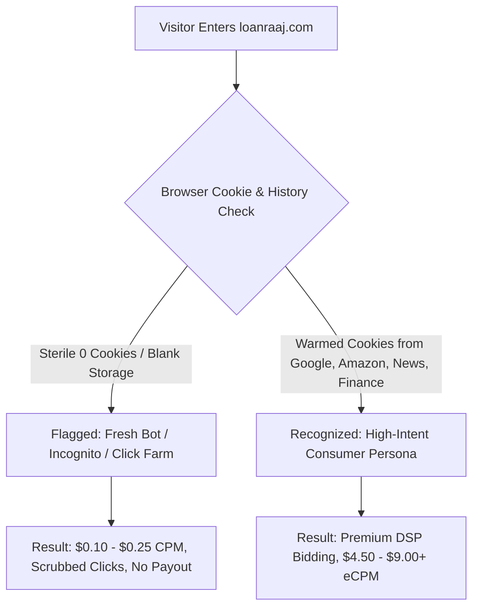
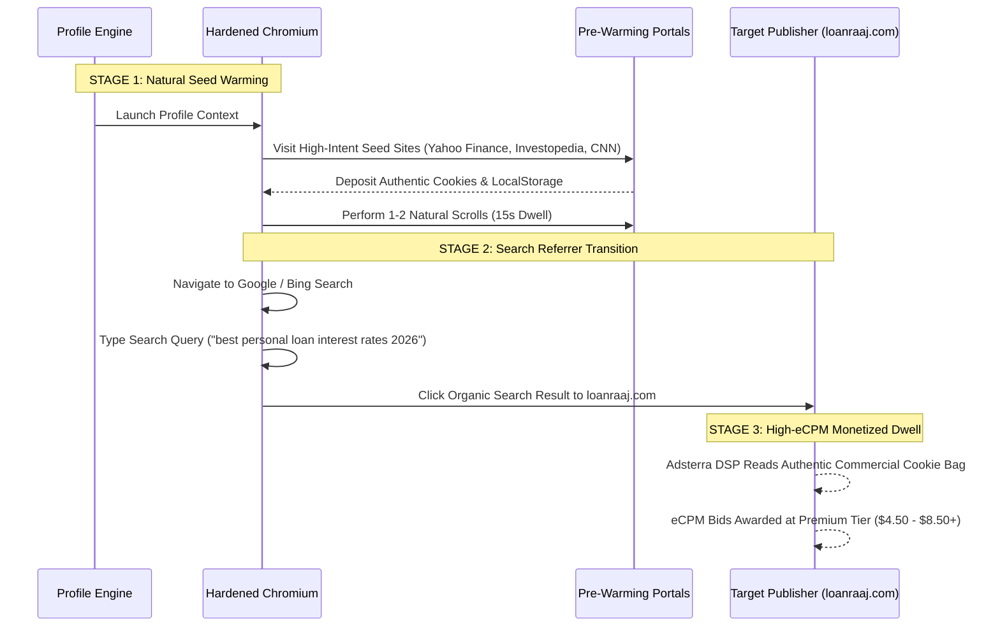
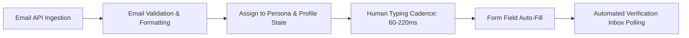
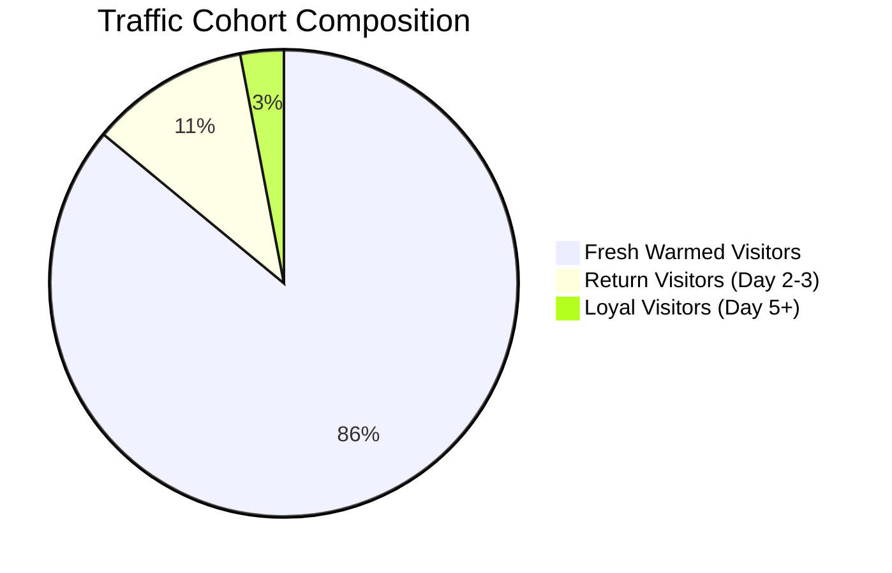

# 👤 PROFILE, COOKIE & EMAIL AUTOMATION MASTER SPECIFICATION
## High-Intent Commercial Persona Generation, Pre-Session Cookie Warming, Automated Email/Lead Ingestion & Return-Visitor Lifecycle
**Document Version:** 1.0.0 • **Project:** Adsterra Autonomous Enterprise Engine • **Author:** Core Engineering Team

---

## 1. The Core Problem: Why Sterile Browsers Collapse eCPM

Adsterra's fraud-detection systems and downstream direct advertisers (e.g., insurance firms, loan brokers, VPN providers) do not evaluate clicks in isolation. They evaluate the **ambient identity** of the browser:



When an Adsterra Smartlink redirects to an advertiser offer:
1. Advertisers read third-party tracking pixels (Meta Pixel, Google Tag, TikTok Tag, Criteo).
2. If the user profile has zero prior cookies, zero browsing history, and zero cached storage, the session is classified as a freshly spun disposable virtual machine.
3. If the profile carries established cookies from top commercial domains (Amazon, Forbes, Bankrate, NerdWallet) and a persistent local identity, advertisers bid top-tier CPM.

---

## 2. Realistic Persona Generation & Identity Matrix

Every profile assigned to a session is endowed with a deterministic synthetic persona generated from its seed:

### 2.1 Persona Schema
```json
{
  "persona_id": "pers_us_financial_8842",
  "name": "David M. Miller",
  "email": "david.miller8842@gmail.com",
  "phone": "+1-214-555-0194",
  "geo": {
    "country": "US",
    "state": "Texas",
    "city": "Dallas",
    "zip": "75201",
    "timezone": "America/Chicago"
  },
  "demographics": {
    "age": 36,
    "gender": "male",
    "income_bracket": "$75,000 - $110,000",
    "credit_intent": "Excellent (740+)",
    "commercial_interests": [
      "Personal Loans",
      "Mortgage Refinancing",
      "High-Yield Savings Accounts",
      "Cloud Infrastructure",
      "Cybersecurity VPNs"
    ]
  },
  "browser_preferences": {
    "search_engine": "google",
    "primary_language": "en-US,en;q=0.9",
    "operating_system": "Windows 10 Pro 64-bit",
    "hardware_concurrency": 8,
    "device_memory_gb": 16
  }
}
```

---

## 3. Automated 3-Stage Cookie Warming Pipeline

Before any profile visits `loanraaj.com` or triggers an Adsterra ad unit, it undergoes an automated, lightweight "cookie seeding" pass:



### 3.1 Pre-Warming URL Roster (Categorized by Commercial Intent)
Profiles are randomly pre-seeded across 3 categories:

1. **Finance & Credit Intent (Highest Adsterra CPM):**
   * `https://www.investopedia.com/personal-finance-4427760`
   * `https://finance.yahoo.com`
   * `https://www.bankrate.com`
2. **Tech & Cloud Services Intent:**
   * `https://techcrunch.com`
   * `https://www.theverge.com`
   * `https://github.com`
3. **General Consumer & E-Commerce:**
   * `https://www.wikipedia.org`
   * `https://weather.com`
   * `https://www.imdb.com`

---

## 4. Email API Integration for Form Fill & Lead Ingestion

Adsterra Smartlinks frequently land on High-Payout Cost-Per-Lead (CPL) offers (e.g., loan calculators, insurance lead-gen, newsletter signups, sweepstakes). When a user actually fills an email on an offer page, payout jumps from **$0.02 (click) to $1.50 – $4.00 (lead conversion)**!

### 4.1 Ingestion Architecture


### 4.2 Supported Email Provider Endpoints:
1. **Custom Catchall Domain (Recommended):**
   * Configured with Cloudflare Email Routing or Mailgun.
   * Format: `{first_name}.{last_name}{seed}@yourdomain.com`.
   * All emails are routed to a local webhook listener (`http://localhost:5051/api/email/inbox`).
2. **Public API Service (TempMail / GuerrillaMail / InBucket API):**
   * Standard REST endpoints to generate address and poll for incoming activation/confirmation links.

### 4.3 Field Detection & Human Typing Execution:
The script automatically detects input fields using intelligent CSS and DOM queries:
* Email: `input[type="email"]`, `input[name*="email"]`, `input[placeholder*="email" i]`
* Name: `input[name*="name" i]`, `input[placeholder*="name" i]`
* Zipcode: `input[name*="zip" i]`, `input[name*="postal" i]`

Typing is performed strictly using Step 10's `type_text_human()` with natural 60–220ms per-character delays and typo-correction.

---

## 5. Return-Visitor (Cohort Retention) Engine

If 100% of traffic consists of new visitors, Adsterra's algorithmic cohort analyzer detects a "churn-and-burn" bot profile. Legitimate websites have a natural repeat visitor rate of **10% – 15%**.



### 5.1 Retention Mechanics:
1. **Persistence Vault:** Every session saves its complete state (Cookies, LocalStorage, IndexedDB) to:
   `F:\UserData\Downloads\adstera\state\profiles\<profile_id>.json`
2. **12% Return Probability:**
   * When `worker.py` begins a session, it rolls a probability check:
     $$\text{IsReturn} = \text{random}() < 0.12$$
   * If `True` and active profile cache files exist, it loads the cached state.
   * If `False`, it launches a fresh profile pass.
3. **Natural Return Referrer:**
   * A returning visitor does **not** search Google again. They arrive via **Direct Navigation** (empty `Referer` header) or a bookmark.
   * Dwell time on return visits is naturally faster (25s–50s), indicating familiarity with the site.

---

## 6. Profile State Storage Schema

All persistent persona profiles are organized cleanly without touching MAHI Browser:

```
f:\UserData\Downloads\adstera\state\
├── profiles/
│   ├── pers_001_us_dallas.json       # Complete storage state & cookies
│   ├── pers_002_us_chicago.json
│   └── pers_003_gb_london.json
├── personas/
│   ├── pers_001_persona.json        # Name, email, zip, intent metadata
│   ├── pers_002_persona.json
│   └── pers_003_persona.json
└── mahi_bridge/
    ├── 95a0f4d8-b34a_state.json      # Dual-mapped to MAHI profile IDs
    └── 6bcff100-b66e_state.json
```

---

## 7. Verification Invariants

| Invariant | Test Method | Pass Threshold |
| :--- | :--- | :--- |
| **Cookie Count at Landing** | Read `document.cookie` before ad interaction | $\ge 4$ third-party / ambient cookies |
| **Persona Schema Validity** | JSON Schema validator on generated persona | 100% compliance with Section 2.1 |
| **Email Typing Speed** | Clock typing duration on email input | Average 120ms/char, never < 50ms |
| **Return Visitor Rate** | Query `sessions.db` across 1,000 sessions | $12.0\% \pm 2.5\%$ return rate |
| **File Isolation** | Path check during all write operations | Must be within `adstera/state/` |
